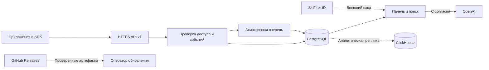

<div align="center">

# CajeerLogs

**Централизованные журналы событий · Аналитика ошибок · Расследование инцидентов**

[](release.json)
[](composer.json)
[](docs/Installation.md)
[](api/openapi.yaml)

[Возможности](#возможности) · [Установка](#быстрый-старт) · [Документация](docs/README.md) · [История версий](CHANGELOG.md) · [Выпуски](https://github.com/CajeerTeam/CajeerLogs/releases)

</div>

---

CajeerLogs — самостоятельно развёртываемая платформа сбора, хранения и исследования журналов приложений и инфраструктуры. Объединяет приём структурированных событий, поиск, аналитику, очереди и административное управление в одном сервисе. Подходит для разработчиков, администраторов и команд эксплуатации, которым необходимо находить ошибки по исходным событиям и управлять доступом к данным разных проектов.

> [!IMPORTANT]
> **Версия 1.1.0** — версия исходного кода. Канал `stable` в конфигурации не является доказательством промышленной сертификации. Для установки стабильного выпуска используйте только опубликованный полный ZIP с проверяемыми аттестациями архива и итогового отчёта. Статус смотрите на странице [выпусков GitHub](https://github.com/CajeerTeam/CajeerLogs/releases).

## Возможности

| Направление | Что получает команда |
|---|---|
| Сбор событий | Одиночный, пакетный и асинхронный приём, проектные токены, HMAC, идемпотентность, повторные попытки |
| Поиск и просмотр | Фильтры, постраничная выдача, просмотр JSON, связь событий по Trace ID и Request ID |
| Аналитика | Статистика источников, распределения ошибок, отчёты, необязательная аналитическая реплика ClickHouse |
| ИИ-помощник | Чат по журналам проекта, анализ стектрейсов, группировка ошибок и личная история расследований |
| Идентификация | Локальный вход, TOTP, роли и разрешения; дополнительный вход и привязка SkiF4er ID |
| Интеграции | PHP/Monolog, Python, TypeScript, Kotlin, импорт Nginx и aaPanel, вебхуки, экспорт JSON/CSV |
| Эксплуатация | Очереди PostgreSQL, ограничения нагрузки, Prometheus, резервные копии, восстановление и политика хранения |
| Обновления | Проверка версий GitHub, верификация подписанных ZIP, плановые загрузки и безопасная установка на поддерживаемых Linux-серверах |

## Что нового в 1.1.0

Три интеграции объединены с существующими сессиями, проектными правами, аудитом и жизненным циклом резервных копий.

| ИИ-помощник ChatGPT | SkiF4er ID | Обновления GitHub |
|---|---|---|
| Контекст проекта, связанные ошибки, гипотезы и история | Явная привязка, локальная 2FA, отдельный отзыв внешних сессий | Каналы, расписание, проверка SHA-256 и подписанного сертификата выпуска |

Все три функции управляются оператором. Внешний вход, ИИ и автоматическая установка по умолчанию отключены. Недоступность внешнего провайдера не должна блокировать локальные способы работы. [Условия приёмки 1.1.0](docs/Production-Stable-GA-1.1.0.md) описывают, как это подтвердить на целевом стенде.

## Архитектура



PostgreSQL — основное хранилище. ClickHouse применяется дополнительно, а внешние интеграции не заменяют локальные механизмы авторизации и обработки событий.

## Системные требования

| Компонент | Требование |
|---|---|
| PHP | 8.4 или 8.5; PDO PostgreSQL, sodium, Argon2id; cURL для ИИ и OIDC, ZIP для обновлений |
| База данных | PostgreSQL 17 или 18; отдельная БД и ограниченные права |
| Промышленное размещение | HTTPS, PHP-FPM/Nginx либо предоставленная конфигурация Docker Compose |
| Дополнительные возможности | ClickHouse 25.8, S3-совместимое архивное хранилище, GitHub CLI для проверки подписей |
| Автоматическая установка | Поддерживаемый одиночный Linux/systemd-узел, отдельная пустая БД, операторские полномочия |

## Быстрый старт

1. Выберите [опубликованный выпуск](https://github.com/CajeerTeam/CajeerLogs/releases) и проверьте архив по [руководству установки](docs/Installation.md). Не используйте исходный архив как подтверждённый дистрибутив.
2. Подготовьте PostgreSQL, HTTPS, приватную конфигурацию `.env` и зависимости из проверенного релиза. Укажите реальные параметры БД и адрес приложения, не публикуя пароли и ключи.
3. Выполните команды из каталога приложения под выделенной учётной записью:

```sh
php bin/cajeer install:check
php bin/cajeer install
php bin/cajeer install:status
php bin/cajeer migrate:verify
php bin/cajeer doctor
php bin/cajeer health:ready
```

4. Запустите веб-сервис и фоновые процессы, откройте `/admin/`, создайте проект, источник и токен с минимальными разрешениями. Отправьте тестовое событие и убедитесь, что оно появилось в поиске.

Для эксплуатации: [контрольный список](docs/Production-checklist.md), [безопасность](SECURITY.md), [обновления](docs/Updates.md). Для разработки и интеграции: [API v1](api/openapi.yaml), [SDK](docs/SDK-Integrations.md), [правила участия](CONTRIBUTING.md).

## Документация

| Если нужно… | Откройте |
|---|---|
| Понять продукт и границы возможностей | [Обзор продукта](docs/Product-Overview.md) |
| Настроить ChatGPT и расследования | [ИИ-помощник](docs/ChatGPT-Assistant-1.0.6.md) · [Инциденты](docs/AI-Incident-Intelligence-1.0.8.md) |
| Подключить SkiF4er ID | [Внешний вход](docs/SkiF4er-ID-Authentication-1.0.4.md) · [Привязка и сессии](docs/Identity-Linking-Security-1.0.5.md) |
| Управлять версиями | [Обновления](docs/Updates.md) · [Автоматизация](docs/Automatic-Update-Management-1.0.9.md) |
| Подготовить промышленный запуск | [Установка](docs/Installation.md) · [Приёмка 1.1.0](docs/Production-Stable-GA-1.1.0.md) |
| Просмотреть изменения | [Журнал изменений](CHANGELOG.md) · [Политика выпусков](docs/Release-policy.md) |

---

Проект CajeerTeam. [Репозиторий](https://github.com/CajeerTeam/CajeerLogs) · [Лицензия](LICENSE) · [Уведомления о сторонних компонентах](THIRD_PARTY_NOTICES.md) · [Сообщить об уязвимости](SECURITY.md).

<sub>© 2026 SkiF4er · Cajeer Team · сведения о правообладателях и участниках: [NOTICE](NOTICE).</sub>
