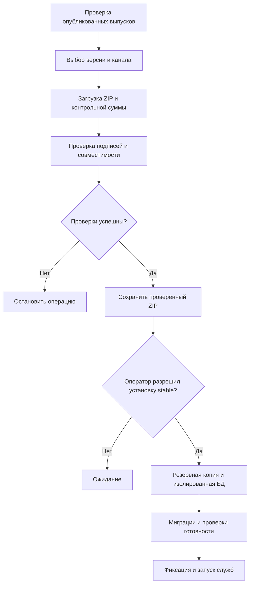

# Управление обновлениями CajeerLogs 1.1.0

Обновления ядра поступают из [GitHub Releases CajeerTeam/CajeerLogs](https://github.com/CajeerTeam/CajeerLogs/releases). Модули, плагины и темы имеют отдельный реестр. Проверка версии, загрузка и установка — разные операции с разными гарантиями.

| Операция | Команда | Руководство |
|---|---|---|
| Обнаружение | `update:check` | [Проверка версий](GitHub-Release-Discovery-1.0.1.md) |
| Загрузка | `update:download` | [Подписи и совместимость](Verified-Update-Downloads-1.0.2.md) |
| Повторная проверка | `update:verify VERSION` | [Проверенная загрузка](Verified-Update-Downloads-1.0.2.md) |
| Установка | `update:install VERSION` с обязательными параметрами | [Безопасная установка](Safe-Update-Installation-1.0.3.md) |
| Восстановление | `update:status`, `update:recover --confirm` | [Восстановление](Safe-Update-Installation-1.0.3.md) |
| Расписание | `update:auto-configure`, `update:auto-status`, `update:auto-tick` | [Автоматизация](Automatic-Update-Management-1.0.9.md) |

Команды запускаются как `php bin/cajeer ...` из каталога приложения. Панель «Система» показывает журнал изменений, подтверждённый ZIP, статус планировщика и уведомления. Установка выполняется оператором либо разрешённой системной автоматикой, не браузером. Preview не допускается к автоматической установке. С версии 1.1.0 stable требует подписанного итогового сертификата, связанного с SHA-256 архива. Неполные доказательства, неподписанные или несовместимые файлы блокируют операцию.

Автоматическое обновление выключено изначально. Начните с `check`. Перед `install` репетируйте реальную установку на соответствующем Linux/systemd-хосте, включая резервное копирование и восстановление. Docker и другие неподдерживаемые типы размещения обновляются вручную по [руководству](Installation.md).
